<div align="center">
  

  <p><code>Every section and project from The Ultimate Bootstrap 5 Course, from the grid to full multi-page sites.</code></p>

  <p>
    <a href="https://github.com/Saji-d/bootstrap-learning-journey"></a>
    
    
  </p>
  <p>
    
    
    
    
  </p>

  <p>
    <a href="#-overview">Overview</a> ·
    <a href="#-highlights">Highlights</a> ·
    <a href="#-featured-projects">Featured Projects</a> ·
    <a href="#-what-is-inside">What is Inside</a> ·
    <a href="#-tech-stack">Tech Stack</a> ·
    <a href="#-how-to-run">How to Run</a> ·
    <a href="#-author">Author</a>
  </p>
</div>


## ◈ Overview

This repository contains everything I built while completing **The Ultimate Bootstrap 5 Course From Beginners to Advanced**. The work was done during my BSS internship learning journey, practising responsive UI components and real-world pages with Bootstrap 5.

It is a **learning repository, not a product**. The first seven sections are small topic pages. The last three are larger multi-page projects deployed on Vercel.


## ◈ Highlights

<table>
  <tr>
    <td width="33%" valign="top"><b>Grid system</b><br>Grid basics, alignment, gutters, responsive breakpoints and eight grid exercises.</td>
    <td width="33%" valign="top"><b>Forms and validation</b><br>Controls, layouts, input groups and a validation page with its own script.</td>
    <td width="33%" valign="top"><b>UI components</b><br>Alerts, badges, buttons, cards, list groups, modal and navbar.</td>
  </tr>
  <tr>
    <td valign="top"><b>Helpers and utilities</b><br>Spacing, flex, display, sizing, borders, shadows, position and z-index.</td>
    <td valign="top"><b>Dashboard layout</b><br>An employee management system with dashboard, employee and job lists.</td>
    <td valign="top"><b>Multi-page sites</b><br>A blog app and an education website, each with its own pages and styles.</td>
  </tr>
</table>


## ◈ Featured Projects

| Project | What it covers | Live | Source |
|---------|----------------|------|--------|
| Employee Management System | Dashboard, employees list and jobs list | [Live](https://bootstrap-employee-management-system.vercel.app) | [Code](08-employee-management-system) |
| Blog Application | Home, posts, single page and search | [Live](https://bootstrap-blog-app.vercel.app) | [Code](09-blog-app) |
| Real World Education Website | Courses, blog, FAQ, about and contact pages | [Live](https://bootstrap-real-world-education-website.vercel.app) | [Code](10-real-world-education-website) |

Each project is deployed separately on Vercel by selecting its folder as the root directory.


## ◈ What is Inside

Ten numbered sections that follow the order of the course. Each topic folder is a standalone `index.html`.

<details>
<summary>Open the folder map</summary>

```text
bootstrap-learning-journey/
├── 01-basics/                          bootstrap-setup, hello-bootstrap
├── 02-grid-layout/                     grid-basics, alignment, gutters-spacing, responsive-grid, exercise-grid-1 to 8
├── 03-content-styling/                 colors, images, tables, typography
├── 04-forms/                           basic-forms, form-controls, form-layout, input-groups, validation
├── 05-components/                      alerts, badges, buttons, cards, list-group, modal, navbar
├── 06-helpers/                         clearfix, colors-background, links, position, ratio, stacks, text, visibility
├── 07-utilities/                       background, borders, display, flex, position, shadows, sizing, spacing, text, visibility, z-index
├── 08-employee-management-system/      dash, employees-list, jobs-list
├── 09-blog-app/                        index, posts, page, search, default, style.css, images/
└── 10-real-world-education-website/    index, about, courses, single-course, blog, single-post, faq, contact, style.css, images/
```

</details>


## ◈ Tech Stack

| Layer | Technologies | Purpose |
|-------|--------------|---------|
| Framework | Bootstrap 5 | Grid, components, helpers and utilities |
| Markup and style | HTML5, CSS3 | Page structure and custom styles |
| Behaviour | JavaScript | Form validation script |
| Hosting | Vercel | Live demos of the three projects |


## ◈ How to Run

There is nothing to install. Clone the repository and open any page in a browser.

```bash
git clone https://github.com/Saji-d/bootstrap-learning-journey.git
cd bootstrap-learning-journey
start 10-real-world-education-website/index.html
```


## ◈ Author

**Sajidur Rahman Sajid**: Full-Stack Developer and AI engineer from Dhaka.<br>
BSc in CSE at American International University-Bangladesh (AIUB).

<p>
  <a href="https://www.sajidur.me"></a>
  <a href="https://www.linkedin.com/in/sajidur-rahman-sajid/"></a>
  <a href="https://github.com/Saji-d"></a>
  <a href="mailto:sajidsajidurrahman99@gmail.com"></a>
</p>

<sub>Completed during my BSS internship learning journey.</sub>
